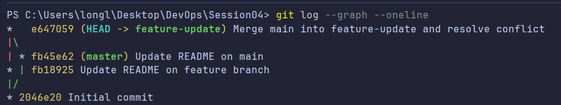

# Bài 2: Quản lý nhánh và giải quyết xung đột

## 1. Các bước thực hiện

* Khởi tạo repository Git và tạo commit ban đầu trên nhánh `main`.
* Tạo nhánh `feature-update`, chỉnh sửa nội dung file `README.md` và commit.
* Chuyển về nhánh `main`, chỉnh sửa cùng dòng nội dung trong `README.md` và commit.
* Chuyển lại `feature-update`, thực hiện lệnh `git merge main` để tạo ra xung đột.
* Mở file `README.md`, xác định các vùng xung đột thông qua ký hiệu `<<<<<<<`, `=======`, `>>>>>>>`.
* Chỉnh sửa nội dung thủ công, xóa các ký hiệu đánh dấu và lưu lại file.
* Sử dụng `git add README.md` và `git commit` để hoàn tất quá trình gộp nhánh.

## 2. Kết quả

Đã giải quyết xung đột thủ công trên file `README.md`. Nội dung sau khi chỉnh sửa đã loại bỏ hoàn toàn các ký hiệu xung đột.

Lệnh `git log --graph --oneline` hiển thị lịch sử phân nhánh và merge commit có hai nhánh tổ tiên, xác nhận quá trình gộp nhánh đã hoàn thành.

## 3. Minh chứng

